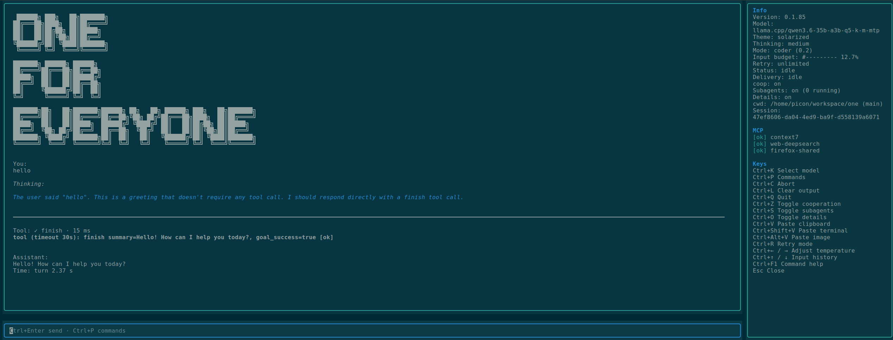

# ONE



[Website](https://one.noxgle.com/) · [Documentation](https://one.noxgle.com/docs/)

## Why ONE?

I believe the future of AI is **local-first**.

- **Local-first.** Most everyday AI tasks should run on your own hardware.
- **You decide.** Local, cloud, or hybrid — the choice is yours.
- **The future is local.** Local models will power the future of everyday work.

**Your hardware. Your models. Your rules.**

ONE is a local-first autonomous
Python terminal agent: TUI, one-shot text/JSON, headless tasks and JSON-lines RPC.
Use Ollama or llama.cpp locally, hosted providers, or a hybrid setup.

[](https://github.com/noxgle/one/actions/workflows/ci.yml)
[](LICENSE)

## Install and start

For container installation, see **[Running ONE with Docker](website/src/content/docs/library/docker.md)**.

Requires Python **3.12+**. A virtual environment avoids system-package conflicts:

```sh
python3 -m venv .venv
. .venv/bin/activate
python -m pip install one-agent
one --version
one --help
```

With an Ollama server already running and a model installed, replace `MODEL_NAME`
with its actual name:

```sh
one --provider ollama --model MODEL_NAME --ollama-url http://localhost:11434/v1
```

For hosted providers, configure authentication before running a task. Follow the
[quickstart](website/src/content/docs/library/quickstart.md) or the
[local-first guide](website/src/content/docs/guides/local-first-quickstart.md).

## Documentation

The **[documentation portal](https://one.noxgle.com/docs/)** is the canonical
manual. Its [Markdown sources](website/src/content/docs/index.md) are maintained
in this repository. It includes:

- [Installation](website/src/content/docs/handbook/installation.md) and
  [updates](website/src/content/docs/handbook/updating.md)
- [TUI, shortcuts, slash commands and modes](website/src/content/docs/handbook/choose-a-mode.md)
- [Sessions and configuration](website/src/content/docs/handbook/sessions-and-configuration.md)
- [Providers and authentication](website/src/content/docs/handbook/providers-and-authentication.md)
- [Safety and cooperation](website/src/content/docs/handbook/cooperation-and-safety.md),
  [presets and readonly](website/src/content/docs/library/presets.md)
- [CLI](website/src/content/docs/reference/cli.md),
  [settings](website/src/content/docs/reference/settings.md),
  [tools](website/src/content/docs/reference/tools.md),
  [automation and RPC](website/src/content/docs/guides/automation-rpc.md)
- [MCP](website/src/content/docs/handbook/integrations.md),
  [skills](website/src/content/docs/library/skills.md) and
  [extensions](website/src/content/docs/library/extensions.md)
- [FAQ](website/src/content/docs/library/faq.md) and
  [Doctor](website/src/content/docs/library/doctor.md)

The Astro + Starlight portal builds locally to static files and is uploaded
**manually**. See [website/README.md](website/README.md) for preview, build,
subdirectory hosting, upload and rollback. No production domain is assumed;
repository links above remain usable before hosting is configured.

## Safety and maturity

ONE tools, extensions and MCP servers run with your permissions. For an untrusted
repository use `one --no-extensions --no-mcp`. `--preset readonly` restricts
ONE-mediated actions; it is **not an OS or network sandbox**. State, sessions,
reports and checkpoints may contain sensitive data. Never commit credentials.

ONE is alpha (`0.1.x`); APIs and storage may change. Linux is the primary platform;
Windows is best-effort with no Windows CI. Some features are explicitly
experimental. The portal's [audit status](website/src/content/docs/maintainers/migration.md)
lists reference gaps rather than claiming an exhaustive contract review.

## Development

See [CONTRIBUTING.md](CONTRIBUTING.md), [AGENTS.md](AGENTS.md),
[architecture](website/src/content/docs/library/architecture.md),
[CHANGELOG.md](CHANGELOG.md), and [TODO.md](TODO.md).
No Node.js dependency is required to install or run the Python application.

[MIT license](LICENSE)
