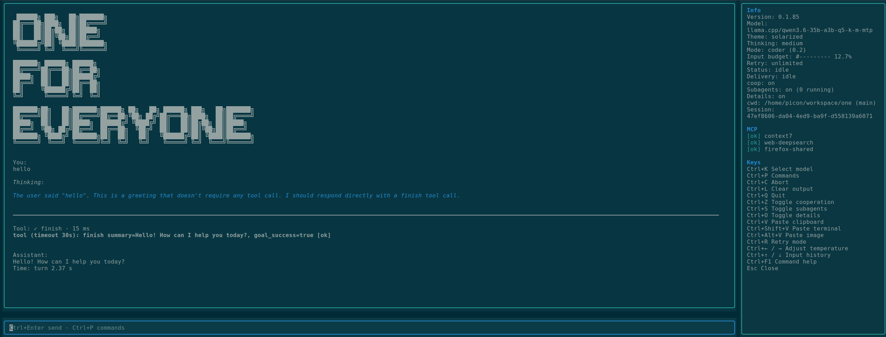

# one



```
 ██████╗ ███╗   ██╗███████╗
██╔═══██╗████╗  ██║██╔════╝
██║   ██║██╔██╗ ██║█████╗
██║   ██║██║╚██╗██║██╔══╝
╚██████╔╝██║ ╚████║███████╗
 ╚═════╝ ╚═╝  ╚═══╝╚══════╝
```


[Full TUI logo artwork](https://github.com/noxgle/one/blob/main/one/assets/logo.txt)

[](https://github.com/noxgle/one/actions/workflows/ci.yml)
[](LICENSE)
[](pyproject.toml)

`one` is an autonomous Python terminal agent with **15 built-in tools**:
`read`, `read_image`, `bash`, `edit`, `write`, `grep`, `find`, `ls`,
`web_connect`, `evidence_read`, `finish`, `plan`, `spawn_subagent`, `ask_user`, and
`apply_patch`. It can plan, use files and shell tools, retrieve HTTP(S) pages
with the built-in [`web_connect`](#native-http-retrieval-web_connect) tool
without bash or an MCP server, verify work, and report a result. It also supports approval gates, steering, questions, sessions, MCP
tools, extensions, skills, and image input.

> **Maturity:** Alpha (`0.1.x`). Public APIs, tool contracts, and storage
> formats may change in `0.1` releases. See [CHANGELOG.md](CHANGELOG.md) and
> [TODO.md](TODO.md).

## Table of contents

- [Quick start](#quick-start)
- [Installation](#installation)
- [Beginner guides](#beginner-guides)
- [Updating](#updating)
- [Choose a mode](#choose-a-mode)
  - [Command center (Ctrl+P)](#command-center-ctrlp)
  - [Model picker (Ctrl+K)](#model-picker-ctrlk)
- [Headless tasks with `one run`](#headless-tasks-with-one-run)
- [Providers and authentication](#providers-and-authentication)
- [Sessions and configuration](#sessions-and-configuration)
  - [TUI session browser](#tui-session-browser)
  - [Generation budget](#generation-budget)
  - [Built-in HTTP retrieval (`web_connect`)](#native-http-retrieval-web_connect)
- [Images](#images)
- [Cooperation and safety](#cooperation-and-safety)
- [Integrations](#integrations)
- [Diagnostics](#diagnostics)
- [Development](#development)
- [References](#references)

## Quick start

```bash
export OPENAI_API_KEY=sk-...
one run "summarize README.md" --provider openai --model gpt-4o-mini
```

For an interactive terminal UI, start `one` (the default mode is TUI) or use
`one --mode tui`. To authenticate interactively, start the TUI and use:

```text
/login openai sk-... gpt-4o-mini
/login status
```

## Beginner guides

New to `one`? Follow the five-minute [Quickstart](docs/QUICKSTART.md), then
copy a task from the [prompt examples](docs/EXAMPLES.md). If something does
not work, use the [FAQ and troubleshooting guide](docs/FAQ.md).

## Installation

### From source

```bash
git clone https://github.com/noxgle/one.git
cd one
python3 -m venv .venv
source .venv/bin/activate
pip install -e '.[dev]'
one --help
```

### From PyPI

```bash
pip install one-agent
one --help
```

The distribution name is `one-agent`; the import and console-script name are
`one`. The version source is `one/config.py:VERSION`.

Verify an installation with `one --version`, `one --help`, or
`python -m one --help`.

## Updating

### Installation from PyPI

Upgrade the installed distribution with:

```bash
python -m pip install --upgrade one-agent
one --version
```

On Windows PowerShell, use the same command with the Python launcher if needed:

```powershell
py -3.12 -m pip install --upgrade one-agent
one --version
```

### Installation from source

Pull the latest changes and refresh the editable installation:

```bash
git pull
python -m pip install -e '.[dev]'
one --version
```

Updating the package does not remove user configuration, credentials, or saved
sessions. These are stored outside the repository under `~/.config/one` by
default (or under `ONE_CODING_AGENT_DIR` when configured). For a virtual
environment, activate it before running the commands above or use that
environment's Python executable explicitly.

## Choose a mode

`--mode` accepts exactly `tui`, `text`, `json`, or `rpc`. `one run <task>` is a
distinct headless subcommand outside `--mode` routing, not a `--mode` value.
The default settings select the TUI.

| Interface | Interactive | Input | Output | Startup banner | Images | Best for |
| --- | --- | --- | --- | --- | --- | --- |
| `--mode tui` | Yes | Textual editor and slash commands | Rendered stream | Yes | `--image`, pasted/path images, `read_image` (runtime) | Human-driven work |
| `--mode text` | No | Positional messages | Last assistant text | Yes, unless `quietStartup` is set | Startup `--image` | Simple one-shot text output |
| `--mode json` | No | Positional messages | JSON object containing session `messages` | Yes, unless `quietStartup` is set | Startup `--image` | One-shot session data |
| `--mode rpc` | Yes, protocol-driven | One JSON object per stdin line | JSON event/response object per stdout line | No | Startup `--image`; prompt `attachments` | Orchestrators and UI clients |
| `one run` | No | Required task argument | Summary, or a result JSON object with `--json` | Yes unless `--json` or `quietStartup` suppresses it | Startup `--image` | Autonomous CI/headless tasks |

`--mode text` is **not** an interactive REPL. It sends the supplied positional
message or messages and prints after they finish. Do not use `--mode cli`:
it is not an accepted CLI mode.

### TUI

```bash
one
one --mode tui --provider openai --model gpt-4o-mini
one --mode tui --image screenshot.png
```

The Textual TUI is the human-facing interface. It streams responses, displays
tool lifecycle status, retains sessions, and accepts slash commands such as
`/help`, `/agents`, `/steer`, `/follow`, `/abort`, `/login`, and `/mcp list`. It displays a
startup banner and status information.

In explicit TUI mode, Textual owns the UI loop while the agent runtime owns a
separate worker loop. The UI exchanges bounded, detached command/event DTOs
with that runtime; it does not access live session state. This improves
isolation from blocked runtime I/O, but threads still share the Python GIL and
do not provide a security sandbox or an unconditional latency guarantee.

Subagent headers show the effective preset name and actual provider/model.
Legacy history without preset metadata keeps its model-only label. Invalid
provider/model selections return an error to the parent; models dynamically
served by supported providers remain allowed. Permanent model/access errors
end the child as failed rather than waiting indefinitely in unlimited retry.

`/agents` opens a read-only monitor for direct child agents of the current
session only. The inspector fills the terminal, with a fixed status header and
keyboard-help footer. It opens at the beginning of one timeline: the complete,
redacted task prompt followed by recorded work, without a Tab switch. Long prompts
and results are split into bounded pages with wrapped lines and preserved indentation.
Older journals explicitly identify summary-only prompts. Full-prompt recording
applies to newly started children. Home loads the beginning; End selects recent
activity and enables live following. PageUp/PageDown browse pages; Up/Down scroll
within a page and pause following. Operation blocks update in place from running
to success/failure, retaining their arguments and detail-gated results. Paused pages
refresh operation states without jumping to the tail. Block colors use the current
theme. Provider-emitted display Thinking deltas appear in a Thinking block and
activity indicator; no hidden reasoning is inferred when the provider supplies none.
Left/Right select a child; N/P browse pages of 20 children, including older
completed runs. Large bodies are split into bounded pages rather than silently
removed from the journal. The window is read-only and never switches sessions.

Saved parent sessions keep a private `.jsonl.agents` SQLite sidecar, separate from
provider context. Resume restores recorded runs; unfinished runs are marked
interrupted. Deleting a parent removes its journal. Ephemeral sessions use a private
temporary journal that is removed when the session is disposed. Old sessions do
not gain retrospective history, and forks start a new journal. Only visible,
sanitized display data is recorded, including provider-emitted Thinking text but
not undisclosed model reasoning, raw tool arguments,
images, or complete evidence payloads. Result text is recorded only while details
are enabled and is hidden from history pages when details are off. This is a
recorded display history, not an unlimited raw tool-output archive; existing
result projections and redaction still apply. Journals grow on disk with recorded
work, while UI pages and preview caches stay bounded.

Click an application-generated inline **[view]** link beside a `spawn_subagent`
tool call to open the same monitor with that child selected. `/subagents on|off`
remains only the enable/disable control for subagent tools.

Completed durable tool results can also have an application-generated **[view]**
action. It opens a bounded, sanitized page viewer; PageUp/PageDown retrieves the
next worker-side page. It never exposes tool arguments or raw evidence records,
and links become unavailable after a session change or unavailable evidence.

Configure the startup information panel in `settings.json`:

```json
{"tui": {"infoPanel": "top", "toolResultPreviewLines": 100}}
```

`top` is the default minimal layout with no right sidebar; `sidebar` enables the
detailed right sidebar. These startup settings retain their existing semantics.
`toolResultPreviewLines` controls the positive 1–1000 logical-line limit for
tool-result previews (default `100`); larger results retain a safe `[view]`
action when durable evidence is available.
At runtime, the information layouts are mutually exclusive:

- `/layout compact` shows the top status panel and hides the detailed sidebar.
- `/layout wide` hides the top status panel and shows the detailed right sidebar.
- `/layout focus` hides both information panels.

Use `/sidebar hide` or `/sidebar show` to hide or show the detailed sidebar;
showing it selects the `wide` layout, while hiding it from `wide` returns to
`compact`. The separate visual logo in the conversation window remains visible
in every layout and is not transcript content. The top status panel explicitly
shows `COOP: ON` or `COOP: OFF`.

Current application shortcuts are:

| Shortcut | Action |
| --- | --- |
| `Ctrl+P` | Command center: search actions and open submenus |
| `Ctrl+K` | Searchable provider/model picker; Enter applies for this session and `Ctrl+S` also saves the default |
| `Shift+Tab` | Next preset (main input, idle only; wraps to the first preset) |
| `Ctrl+C` | Abort turn |
| `Ctrl+L` | Clear stream |
| `Ctrl+Q` | Quit |
| `Ctrl+Z` | Toggle cooperation |
| `Alt+A` / `Alt+R` | Approve / reject the pending tool approval |
| `Ctrl+S` | Toggle subagents |
| `Ctrl+O` | Toggle bash output |
| `Ctrl+V` | Paste host/system clipboard text |
| `Ctrl+Shift+V` | Paste terminal text (SSH-safe) |
| `Ctrl+Alt+V` | Paste an image from the system clipboard |
| `Ctrl+T` | Cycle thinking level (same as `/thinking-cycle`; main view only) |
| `Ctrl+Left` / `Ctrl+Right` | Decrease / increase temperature |
| `Ctrl+R` | Cycle retry mode (`off` → `on` → `unlimited` → `off`) |
| `Ctrl+Up` / `Ctrl+Down` | Navigate the local input history (up to 50 prompts and commands) |
| `Ctrl+F1` | Show slash-command help |
| `Esc` | Close the shortcuts panel |

Use `/paste-image` if the terminal intercepts `Ctrl+Alt+V`.

#### Command center (Ctrl+P)

Open **Ctrl+P** to search grouped session, model/agent, tools, appearance, and
help actions. Search by name, description, shortcut, or slash command; selected
Polish aliases such as `sesje` and `motyw` are also supported. Toggle actions
show their current ON/OFF state, and unavailable actions explain why.

Use Up/Down or PageUp/PageDown to navigate, and Enter or a mouse click to run an
action or open its choices. Themes, presets, thinking levels, temperature,
layout, and sidebar visibility have submenus. Esc returns from a submenu or
closes the command center; Ctrl+P closes the command center directly. Opening
and cancelling it preserves the conversation draft.

Choose **Sessions** to open the [session browser](#tui-session-browser), or
**Select model** to open the model picker below.

#### Model picker (Ctrl+K)

**Ctrl+K** opens a searchable list of available models with a provider filter.
Search tokens match the provider and model ID (and a display name when supplied).
The current model is marked `●`; the selected model's full ID, context limit,
reasoning capability, and image-input capability appear below the list.
`unknown` means metadata is unavailable, not that the model has zero capacity.

- Up/Down, PageUp/PageDown, and the mouse navigate the list.
- **Session (Enter)** changes the model for the current session only.
- **Default (Ctrl+S)** also saves the selection as the startup default.
- **Cancel (Esc)** or Ctrl+K closes the picker without changing the model or draft.

Model changes are blocked during generation. A selection failure leaves the
picker open with feedback. The meaning of Ctrl+S here is local to this window;
in the main conversation it toggles subagents.

### TUI `/bash` command profile

TUI `/bash <command>` is a restricted, shell-free manual-command interface. Its
default `strict` profile permits a small read-only set (workspace file views,
searches, disk information, and selected Git inspection). Query/change the
**global** profile with `/config tui.manualBashMode` and
`/config tui.manualBashMode dev` (or global `settings.json`); project
`.one/settings.json` cannot enable `dev`.

| Profile | Permitted purpose |
| --- | --- |
| `strict` (default) | `pwd`, conservative `ls`/`tree`/file/search/disk forms, and selected read-only Git forms |
| `dev` | strict plus selected workspace mutations and fixed Python, npm, Cargo, and Go development forms |

Strict families are `pwd`; conservative `ls`, `tree -L`, `cat`, `head`/`tail
-n`, `wc`, `stat`, `file`, `rg`, `grep`, `du`, and `df`; and selected
`git status`, `diff`, `log`, `show`, `branch`, and `rev-parse` forms. The
executables must resolve from `/usr/bin` or `/bin`; a missing tool is denied.

Dev additionally permits `mkdir [-p]`, `touch`, and no-clobber `cp`/`mv` with
selected workspace paths; `git add -- <paths>` and `git restore --staged --
<paths>`; `python -m pytest [-q|-x|--tb=short] [tests]`,
`.venv/bin/python -m ruff check .`, `python -m ruff format --check .`,
`python -m compileall [-q]`, `python -m build`, and `python -m pip check`,
`python -m pip list`, or `python -m pip show <package>`; plus exact `npm test`,
`npm run lint`, `npm run build`, `cargo check`, `cargo test`, `cargo fmt
--check`, `go test`, and `go vet` forms. These are
grammars, not general executable permissions: arbitrary flags remain denied.

This is an invocation restriction, **not an OS sandbox**: it does not sandbox
repository code or eliminate TOCTOU races, and `dev` can execute project code.
Shell operators, redirects, substitutions, arbitrary options, arbitrary
interpreters, and paths outside the workspace are denied. A configured
`shellCommandPrefix` is incompatible with TUI `/bash` and is rejected rather
than run. Existing model `bash`, interactive `/bash`, and RPC bash behavior are
unchanged.

Manual TUI `/bash` commands and their output stay in local session history and
are never sent to the model, including during compaction. They may persist
sensitive output on disk, so avoid printing secrets. This does not apply to the
model `bash` tool: its bounded results remain model context as usual.

### One-shot text and JSON

```bash
# Prints the final assistant text after the prompt completes.
one --mode text "summarize README.md"

# --print is the same one-shot print path.
one --print "summarize README.md"

# Serializes the full session message list.
one --mode json "summarize README.md"

```

Text and JSON modes consume positional messages; they do not read prompts from
stdin and do not offer an interactive approval, question, or steering channel.
The one-shot JSON shape is `{"messages": [...]}`. It is not the result schema
of `one run --json` and it is not JSON-RPC. `--mode json` still shows the
startup banner unless `quietStartup` is configured. A print-mode invocation
with images but no text fails rather than silently succeeding.

### RPC

```bash
one --mode rpc
```

RPC is a long-lived JSON-lines protocol: write one JSON command per stdin line;
read JSON event and response objects from stdout, one per line. It emits no
startup banner, so stdout remains protocol data. A `prompt` command is accepted
before its asynchronous work completes; session events follow on stdout. Include
an `id` to correlate responses and request events.

```json
{"id":"p1","type":"prompt","message":"summarize README.md"}
{"id":"idle","type":"wait_for_idle"}
```

The first command receives a successful response, then prompt/tool/message
events; `wait_for_idle` receives its response after work completes. Use `steer`,
`follow_up`, `abort`, `answer_question`, and `get_pending_questions` for the
corresponding control channels. RPC prompt images use an `attachments` array of
paths. `steer` and `follow_up` reject image attachments. See
[`one/modes/rpc_mode.py`](one/modes/rpc_mode.py) and RPC snapshots under
[`tests/snapshots/rpc/`](tests/snapshots/rpc/) for the implemented command set
and event shapes.

## Headless tasks with `one run`

```bash
one run "fix the failing tests and summarize the changes"
one run "refactor the auth module" --provider openai --model gpt-4o --json
one run @task.txt --param component=auth
one run "implement feature X" --answer-file /tmp/answer.txt --steer-file /tmp/steer.txt
```

`one run <task>` runs the autonomy loop and prints its final summary. It is a
subcommand, not a `--mode` route. `@task.txt` expands the task from that file;
`--param name=value` substitutes `{{name}}` in the expanded task file. For this
subcommand, `--json` is a separate clean-output contract: it suppresses the
startup banner and instead prints exactly:

```json
{"summary":"...","goalSuccess":true,"finished":true}
```

The task command can cooperate with a human without an interactive UI:

- `--cooperation` prompts on stdin before mutating tools; EOF rejects.
- `--answer-file PATH` writes an `ask_user` question to the file and polls until
  its content changes to an answer. Without it, questions receive a deterministic
  “proceed with best judgment” answer.
- `--steer-file PATH` polls for text, submits non-empty contents as steering,
  then clears the file. These channels are text-only.

Exit status is `0` only when the agent finishes with `goalSuccess`; `1` means a
failed, unfinished, aborted, or resumed-without-task result; `2` is usage or
validation failure. More generally, CLI validation errors use `2`; normal
subcommand failures use `1`. TUI and RPC processes normally exit `0` when
closed. `one run` writes a report to `reports.jsonl` when it has an agent dir.

## Providers and authentication

Supported backends include OpenAI-compatible providers, Anthropic, Gemini,
llama.cpp, Ollama, and ChatGPT/Codex. Credential precedence is runtime input,
then stored `auth.json`, then the provider environment variable. Common
variables include `OPENAI_API_KEY`, `ANTHROPIC_API_KEY`, and `GEMINI_API_KEY`.

### Thinking levels

`/thinking <off|on|minimal|low|medium|high|xhigh>` and `/thinking-cycle` save the
selected level as the default for future sessions; a loaded session continues
to use its recorded level. Models without reasoning capability remain at
`off`. `off` omits enabled reasoning where supported. OpenAI-compatible and
Codex APIs use their available effort enums (their highest/lowest available
effort may be used for `xhigh`/`minimal`); Anthropic and Gemini 2.5 use
deterministic thinking-token budgets. Provider and model API restrictions still
determine which controls a request accepts.

### Temperature

Temperature defaults to **balanced (0.5)**. Presets are `coder` (0.2),
`balanced` (0.5), `creative` (0.8), and `experimental` (1.2); numeric values
are rounded to tenths and bounded to `0.0..1.2`. The TUI shows the nearest mode
and exact value and changes it with **Ctrl+Left/Right** or
`/temperature <value|mode>`. Startup accepts `--temperature` and
`--temperature-mode`; numeric wins when both are supplied. `get_state` exposes
temperature through RPC, and `set_temperature` accepts a numeric `temperature`
or preset `mode`. Subagents inherit their parent's effective value unless their
`spawn_subagent` call supplies `temperature` (which wins) or `temperatureMode`.
Anthropic and Codex omit temperature and emit a warning; requests still run.

OpenRouter uses its native `reasoning: {"effort": ...}` request dialect and
streams reasoning separately. Ollama Cloud uses native `think`; `minimal` and
`low` map to `"low"`, `medium` to `"medium"`, `high` and `xhigh` to `"high"`,
and `off` to `false`. ChatGPT/Codex Responses reasoning summaries
also render separately from answer text. Local Ollama and llama.cpp retain their
OpenAI-compatible/local behavior.

For local models, no key is required:

```bash
LLAMA_CPP_BASE_URL=http://127.0.0.1:8080 one --provider llama.cpp --model local
one --provider ollama --model local --ollama-url http://localhost:11434/v1
```

`/login` validates credentials before storing them and refreshes available
models. Anthropic and ChatGPT/Codex also support subscription OAuth login; see
[Subscription login](#subscription-login-oauth). Provider-controlled OAuth
endpoints can change without notice.

### Subscription login (OAuth)

- `/login anthropic subscription` starts Anthropic OAuth. `/login refresh anthropic`
  refreshes models; `/logout anthropic` removes local stored credentials.
- `/login chatgpt subscription` starts ChatGPT/Codex OAuth. Seed Codex models
  are available before a live model list is fetched; `/login refresh chatgpt`
  refreshes it.

`/logout <provider>` removes one-managed runtime/stored credentials locally. It
does not revoke a provider account token or remove environment credentials.

## Sessions and configuration

Named agent presets are documented in [docs/PRESETS.md](docs/PRESETS.md). Use
`one --preset readonly` for app-enforced read-only inspection (not OS or network sandboxing).
List presets with `/preset`, apply one with `/preset readonly`, or use
Ctrl+P → Select preset. Shift+Tab cycles presets from the main input while idle.
Readonly is application policy, not a sandbox; see the preset documentation
for capability ceilings and saved-session behavior.

Optional workspace presets, including Project, Researcher, and coding-agent
profiles, are available under [`extras/presets/`](extras/presets/); copy a
selected preset into the configured agent directory's `presets/` folder to use it.

By default state is private under `~/.config/one`. If `XDG_CONFIG_HOME` is set,
the default becomes `$XDG_CONFIG_HOME/one`; `ONE_CODING_AGENT_DIR` overrides
both locations. State includes `auth.json`, `models.json`, `settings.json`, sessions,
and reports. A project `.one/` directory supplies per-project MCP and extension
configuration. Use `--no-session`, `--session`, `--continue`, `--resume`, or
`--fork` to control session use. Use `--tools <list>` to restrict the agent to
a specific set of tools and `--no-tools` to disable all built-in tools (useful
for agent-only MCP/extension setups).

Session JSONL, durable evidence, and provider context are separate. Provider
context receives bounded tool/MCP previews; durable sessions can retain complete
sanitized results in an evidence sidecar retrievable by the `evidence_read` tool.
See [Cooperation and safety](#cooperation-and-safety) and the slash-command
help for configuration such as `tools.maxSteps` (`0` means unlimited tool steps)
and optional `toolOutputPruning`.

### Native HTTP retrieval (`web_connect`)

`web_connect` is available in Default and Readonly and does not require `bash`.
To restrict a session to retrieval and evidence, for example:

```bash
one --tools web_connect,evidence_read,finish
```

It accepts only `url` (HTTP(S), no embedded credentials) and optional `mode`:
`auto` (default: HTML to Markdown, JSON and text unchanged), `text` (HTML to
plain text), or `raw` (decoded textual source, not a binary download). HTML
extraction preserves tables, links and fenced code; it never executes JavaScript
or fetches embedded resources. Relative links use the final URL. No search,
custom headers, authentication or non-GET methods are provided.

Configure limits in `settings.json` (global/project merge applies):

```json
{
  "webConnect": {
    "timeoutSec": 15,
    "maxResponseBytes": 2000000,
    "maxOutputChars": 12000,
    "maxRedirects": 5,
    "extractMainContent": true,
    "preserveLinks": true,
    "preserveCodeBlocks": true
  }
}
```

`timeoutSec` covers redirects, transfer and processing; an earlier runtime tool
deadline wins. `maxResponseBytes` independently caps encoded transfer bytes and
decoded body bytes. Gzip/deflate are supported; malformed/truncated compression
and byte-limit overflow fail without presenting partial content. `maxOutputChars`
limits the preview, not durable evidence. Retrieve the full permitted output via
the returned `evidenceId` and bounded `evidence_read` calls, following `nextOffset`.
Evidence requires an available session store; a storage failure is reported
rather than returning a fictitious ID. Generic runtime preview limits still apply.

Non-2xx responses, unsupported binary types and invalid JSON in `auto`/`text`
produce errors. `raw` can show invalid JSON source. Missing Content-Type is treated
as text (binary-looking data is rejected); absent/invalid charset falls back to
UTF-8 replacement decoding. Empty successful responses are allowed. Proxy
environment variables are ignored, TLS verification stays enabled, and cookies
are not forwarded between redirects. URL queries/credentials are redacted in tool
runtime diagnostics and metadata, not necessarily in original conversation input
or returned document content. Do not put secrets in URLs or prompts.

**Network access is not sandboxed:** localhost, private networks and metadata
services are reachable if the process can reach them. GET requests may have side
effects. Readonly limits ONE's app-mediated tools, not network reachability;
parent/CLI capability ceilings still apply. Pages and evidence are untrusted
tool data, not instructions. See [SECURITY.md](SECURITY.md).

### Context policy

`context.policy` defaults to `endpoint-max`, using endpoint capacity while
respecting observed server and manual limits. Set `/config context.policy
provider-default` to use a provider-advertised default input budget instead.
Manual smaller limits are retained. Unknown models use an internal estimate only;
see [model capacity metadata](docs/MODEL_CATALOG.md) for diagnostics and caveats.

### Generation budget

`generation.maxOutputTokens` sets the requested per-response output budget
(default: **16384**, positive integer). For example, from the TUI:

```text
/config generation.maxOutputTokens 32768
```

This is not the model's context-window size or a guarantee of backend capacity.
The request is clamped to known model output limits and available context;
reasoning tokens can consume the budget even when the visible answer is short.
Larger budgets may increase latency and usage. Changes affect subsequent
requests. See [model capacity and truncated responses](docs/MODEL_CATALOG.md#generation-limit-and-truncated-responses)
for reserve behavior and output-truncation diagnostics.

### Subagent timeouts

Subagents use `subagents.idleTimeoutSec` (default `1800`) for time without
meaningful provider text/reasoning or tool activity. Set it to `0` only to
disable the idle watchdog. `subagents.maxDurationSec` defaults to `0`, which
disables the separate hard wall-clock cap; a positive value stops even an active
stream at that limit. Existing `subagents.timeoutSec` remains an idle-timeout
alias only when `idleTimeoutSec` is absent.

An idle or maximum-duration timeout returns a failed, incomplete child result
with its session ID and bounded partial diagnostics. It does not claim external
work stopped (`externalState` is `unknown`); inspect that session and external
state before retrying any operation.

### Subagent tools

The optional `spawn_subagent` `tools` list must be non-empty. The child receives
`finish` automatically when that explicit list, or its inherited tool set, omits
it; duplicate tool names are removed while preserving order. Built-in and active
MCP tool names are validated before the child starts.

### TUI session browser

#### Window: Ctrl+P → Sessions

Choose **Sessions** in Ctrl+P to browse persisted sessions for the current
project. The searchable list is ordered by last update and marks the current
session with `●`. Search by title or full ID; the details show the full selected
ID, update time, and message count. Titles may repeat: loading always validates
the exact ID and path, never a title or a replacement row.

Use Up/Down, PageUp/PageDown, or the mouse to navigate. **Load (Enter)** opens
the selected session, **Refresh** reloads the list, and **Back (Esc)** returns
to Ctrl+P with its previous search intact. Opening, searching, or refreshing
this browser does not replace the numbering of a previously displayed
`/sessions` list.

If the conversation draft is nonempty, Load/Enter first asks whether to keep it
and switch; press Load/Enter again to confirm, or Esc to cancel. The draft is
kept after switching. Loading the active session is a no-op. Loading is blocked
while a turn is active; stale selections and failures leave the browser open
with feedback. The list does not load every conversation body, and model
metadata is not currently shown in this browser.

#### Text commands: list, load, rename, delete

Persisted sessions are scoped to the current project/session directory. In the
TUI, `/sessions` lists them newest first with a temporary number, full session
ID, title, age, and message count (`*` marks the active session). The first user prompt automatically becomes the local session
name after whitespace/control-character normalization (up to 64 Unicode
characters); rename it when needed.

```text
/sessions
/sessions 2
/sessions a8c42bd1-9144-42c1-a92d-52ebd540b3dc
/sessions rename 2 Parser investigation
/sessions delete a8c42bd1-9144-42c1-a92d-52ebd540b3dc
yes
```

Load, rename, and delete accept a **number from the last displayed list** or an
**exact full session ID** copied from your list (the UUID above is illustrative).
IDs work without first listing sessions. Titles are descriptive only and may
repeat; neither title selection nor ID-prefix matching is supported. Run
`/sessions` before using a number. Numbers retain the last displayed ordering;
missing or replaced sessions are rejected rather than selecting another session.
Switching, renaming, or deleting invalidates the numbered list; list again before
using another number. `delete` always asks for `yes`; any
other reply cancels it. It deletes the JSONL and its matching durable-evidence
sidecar. Deleting the active session opens a new empty session so the TUI stays
usable. Loading or deleting waits until an active turn has stopped. Use
`--continue` or `--resume` at startup to open the most recently modified session.

## Images

Image input supports PNG, JPEG, and WebP: at most four images per prompt, with
a 10 MB source-file limit and decoded Base64 limited to 5 MiB. Use startup
`--image` (repeatable) or TUI image paste:

```bash
one run "describe this diagram" --image diagram.png
one --mode text "describe this diagram" --image diagram.png
```

Images are transient for the current turn and are not persisted in session JSONL.
Errors and events use only source basenames. Vision-incapable models reject
images before an HTTP request. ChatGPT/Codex vision-capable models send native
Responses API `input_image` parts; invalid or missing blobs fail explicitly.

TUI, text/json, and `one run` accept startup `--image`; RPC accepts startup
images and prompt `attachments`. `read_image` is a runtime tool the agent can
call during its turn to inspect a file; it is not a startup image-input channel
for `--mode text` or `one run`. Steering and follow-up messages are text-only.

## Cooperation and safety

> ## ⚠️ Workspace trust warning
>
> Starting `one` in a repository can execute arbitrary Python from
> `.one/extensions/*.py` and shell commands from MCP configuration in
> `.one/settings.json`. **Use it only in repositories you trust.** To inspect an
> untrusted repository, start with:
>
> ```bash
> one --no-extensions --no-mcp
> ```
>
> Extensions and MCP servers are not sandboxed; they run with `one`’s
> permissions. Cooperation mode is an approval gate, not a sandbox or security
> boundary.

`--cooperation` requests approval before mutating tools (`bash`, `write`,
`edit`, `plan`, and `apply_patch`). In the TUI, toggle it with `Ctrl+Z` and use
the visible Approve/Reject controls (or `Alt+A`/`Alt+R`); normal prompt input
remains available while an approval is pending. Use `Ctrl+A` in the interactive
fallback. Rejections include a reason returned to the agent. Interactive modes provide `/steer`, `/follow`, and abort controls;
RPC and `one run` provide the channels described above.

When cooperation and `ask_user` are both enabled, the model is instructed to
ask one focused question for necessary preferences or genuinely blocking
ambiguity, then resume the same task rather than putting a question in its final
summary.

`apply_patch` validates collisions and symlink paths and uses staging/rollback,
but it cannot guarantee recovery from power loss, hostile concurrent filesystem
changes, or rollback I/O failure. Review changes and retained backups when an
error is reported.

## Integrations

### MCP servers

MCP servers can be configured in global or project `settings.json` with
`mcpServers`. Stdio servers run as child processes; streamable HTTP servers use
their configured URL. Use `--no-mcp` to disable all of them for a run and
`/mcp list|enable|disable` in the TUI. MCP tools are added to the agent prompt.

Stdio servers can opt into runtime recovery after an unexpected process exit or
stdout EOF; recovery remains off by default for stdio. Streamable HTTP servers
recover failed connections by default because they have no child-process monitor.
Set `"restart": false` on an HTTP server to opt out. The following optional
fields belong under `mcpServers.<name>`:

```json
{
  "restart": true,
  "restartDelaySec": 60,
  "maxRestartAttempts": 3,
  "restartExhaustion": "disable",
  "retryIntervalSec": 300
}
```

After each failure, `one` removes that server's tools immediately and waits
`restartDelaySec` before reconnecting. A successful reconnect restores the
tools. At the attempt limit, the `disable` exhaustion policy stops recovery for
that runtime only (the configured `enabled` value is not changed); `retry`
continues at `retryIntervalSec`. `/mcp disable` cancels pending recovery and
persists `enabled: false` until `/mcp enable` resets recovery and persists
`enabled: true`. Recovery never replays the interrupted tool call.

For web search, the [web-deepsearch MCP server](https://github.com/noxgle/mcp-web-deepsearch)
uses DuckDuckGo and can run over stdio. It needs no API key, but its server is
not sandboxed and may require outbound network access.

### Extensions and skills

Extensions, themes, prompts, and skills are discovered by the resource loader.
See [docs/EXTENSIONS.md](docs/EXTENSIONS.md) for discovery paths, `--extension`,
package commands, and hooks. See [docs/SKILLS.md](docs/SKILLS.md) for skill
frontmatter, discovery, trust prompts, and invocation. Skills are metadata in
the system prompt and load only when invoked with `/skill:<name>` or RPC
`invoke_skill`; they are not auto-executed.

## Diagnostics

The opt-in Docker diagnostic runner drives a persistent RPC session in an
isolated disposable workspace and produces bounded telemetry and reports:

```bash
.venv/bin/python scripts/diagnose_long_session.py --json
.venv/bin/python scripts/diagnose_long_session.py --duration 10 --skip-analysis --json
```

It requires Docker and a reachable configured model. Its container is a
containment aid, not a security boundary. Reports may contain sensitive
diagnostic data; artifacts are removed after a successful report unless
`--keep-artifacts` is used. See `--help` for workload, network, endpoint, and
telemetry options.

`--duration` is the scenario-admission window. The final admitted scenario gets
up to 60 seconds to drain after that deadline; reports distinguish a truncated
final scenario, clean shutdown, and runtime failure.

The offline write-tool regression harness uses a loopback fake OpenAI-compatible
provider inside an isolated `--network none` container; it never uses provider
credentials or outbound network access:

```bash
.venv/bin/python scripts/diagnose_write_tool.py --json
```

It writes only hashes and per-case assertions to `write-tool-reports/`; use
`--keep-artifacts` only when inspecting its disposable workspace. The Docker
smoke test is opt-in: `WRITE_TOOL_DOCKER_SMOKE=1 .venv/bin/python -m pytest -q tests/test_write_tool_diagnostic.py`.

## Development

```bash
python3 -m venv .venv
.venv/bin/pip install -e '.[dev]'
export ONE_CODING_AGENT_DIR="$(mktemp -d)"
.venv/bin/python -m pytest -q
.venv/bin/ruff check .
git diff --check
```

The temporary state directory keeps tests away from real credentials and
sessions. Export it again in each new shell used for tests or manual CLI checks.

See [CONTRIBUTING.md](CONTRIBUTING.md) for contributor conventions and focused
test commands. Linux and macOS are supported in CI. Windows is currently
best-effort and is not an officially supported platform yet; shell-oriented
behavior remains experimental pending Windows CI. Windows 11 is the planned
future target, while Windows 10 support is deferred.

## References

- [Website](https://one.noxgle.com/)
- [TODO.md](TODO.md) — roadmap
- [CHANGELOG.md](CHANGELOG.md) — release notes
- [Git history](https://github.com/noxgle/one/commits/main/) — implementation history
- [CONTRIBUTING.md](CONTRIBUTING.md) — development guide
- [SECURITY.md](SECURITY.md) — security policy and reporting
- [docs/QUICKSTART.md](docs/QUICKSTART.md) — five-minute beginner guide
- [docs/EXAMPLES.md](docs/EXAMPLES.md) — copy-and-paste prompt examples
- [docs/FAQ.md](docs/FAQ.md) — FAQ and troubleshooting
- [docs/architecture.md](docs/architecture.md) — internal architecture
- [docs/EXTENSIONS.md](docs/EXTENSIONS.md) — extension contract
- [docs/SKILLS.md](docs/SKILLS.md) — skills contract
- [docs/PRESETS.md](docs/PRESETS.md) — presets and capability policy
- [docs/MODEL_CATALOG.md](docs/MODEL_CATALOG.md) — model capacity and generation budgets
- [docs/RELEASE_CHECKLIST.md](docs/RELEASE_CHECKLIST.md) — release verification
- [CODE_OF_CONDUCT.md](CODE_OF_CONDUCT.md) — community guidelines
